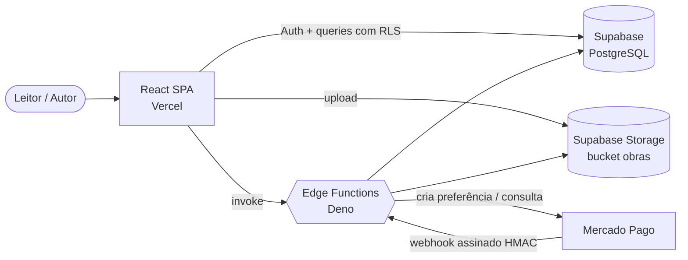
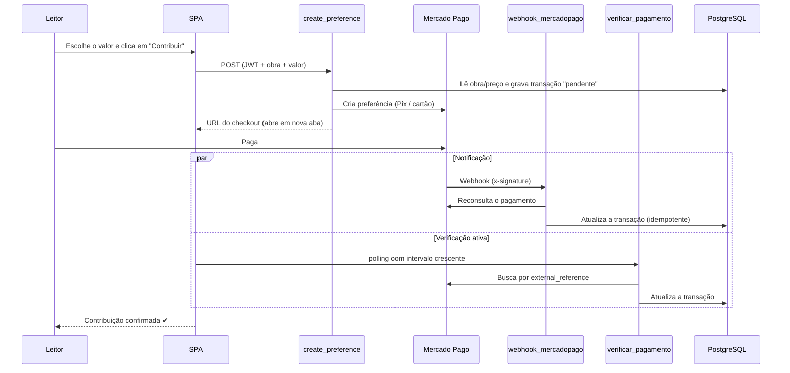

<div align="center">

# ✦ Arte sem Preço

**Biblioteca digital de acesso aberto para autores independentes.**
**A arte tem valor. O preço, você decide.**


</div>

---

## 📖 Sobre o projeto

O **Arte sem Preço** separa o **acesso** à obra do **pagamento** por ela. O leitor baixa qualquer livro na hora, mesmo pagando R$ 0, e contribui com o valor que quiser, quando quiser. Cada contribuição é dividida de forma transparente: **90% para o autor** (ou para a causa social que ele escolheu) e **10% para manter a plataforma**.

É um produto completo em produção: autenticação, catálogo, painel do autor com upload de obras, pagamentos reais via **Pix e cartão**, biblioteca pessoal e recomendações. O backend é **serverless** e roda com custo fixo zero na fase de validação.

> *"A arte não deveria deixar de chegar a alguém porque essa pessoa não pode pagar por ela hoje."*

---

## ✨ Funcionalidades

| Para o leitor | Para o autor |
|---|---|
| 📚 Catálogo com busca e filtro por categoria | ✍️ Painel para publicar e editar obras (PDF/EPUB) |
| 🔓 Download imediato, sem paywall | 🏷️ Até 3 categorias e preço sugerido por obra |
| 💸 Contribuição voluntária via Pix ou cartão | 📊 Acompanhamento dos ganhos recebidos |
| 🕓 **"Pague depois"**: a obra fica na biblioteca com atalho para contribuir | 🤝 Selo **"Arte que Transforma"**: renda destinada a uma ONG |
| 🎯 Recomendações personalizadas a partir do histórico | 📄 Página de créditos (colofão) inserida automaticamente no arquivo |
| 🔗 Links curtos permanentes (`/o/<código>`) impressos em cada obra | 🔁 Leitor pode virar autor a qualquer momento |

---

## 🧠 Destaques de engenharia

Decisões técnicas que vão além do CRUD:

### 💳 Pagamentos confiáveis com Mercado Pago
- **Nunca confia no cliente:** a Edge Function `create_preference` valida o JWT, lê a obra e o preço direto do banco e registra a transação como `pendente` **antes** de redirecionar o usuário.
- **Webhook seguro e idempotente:** valida a assinatura **HMAC-SHA256** (`x-signature`), aceita os formatos Webhook e IPN legado e **reconsulta a API do Mercado Pago** em vez de confiar no corpo da notificação. Notificações repetidas ou forjadas não têm efeito. Todo evento vai para a tabela `webhook_eventos` para conciliação posterior.
- **Não depende do webhook chegar:** a tela de sucesso faz *polling* com intervalo crescente na função `verificar_pagamento`, que busca o pagamento ativamente. Assim, o Pix pago em outra aba libera o download em segundos.
- Regras de pagamento compartilhadas em um único módulo (`_shared/pagamento_mp.ts`), usado tanto pelo webhook quanto pela verificação ativa.

### 📄 Processamento de PDF e EPUB no servidor
- Módulo **puro e testado** (`_shared/colofao.ts`) que acrescenta uma página de créditos ao fim de cada obra, usando `pdf-lib` para PDF e `JSZip` para EPUB 2/3 (*spine*, *manifest* e OPF).
- Trata casos reais: páginas giradas, títulos longos, caracteres fora da fonte, escape de XML e colisão de nomes de arquivo. Recusa com mensagem amigável PDFs com senha ou assinatura digital e EPUBs com DRM.
- **16 testes automatizados com Deno** cobrindo esses cenários.
- O arquivo original do autor é preservado. O link curto também vai para os metadados do arquivo, então continua lá mesmo se alguém apagar a página.

### 🗄️ Banco de dados e segurança
- **PostgreSQL com Row Level Security** em todas as tabelas: cada autor só altera as próprias obras, inclusive no Storage.
- **Migrations versionadas** documentando a evolução do schema (categorias N:N, links curtos, perfis públicos, recomendações).
- **Recomendação content-based em SQL puro** (`obter_recomendacoes`): pontua as obras por autor, causa, categoria e tags em comum com o histórico do leitor, com *fallback* para as novidades.
- Segredos (token do Mercado Pago, segredo do webhook) ficam **apenas** nos secrets das Edge Functions, nunca no bundle do front-end. CORS restrito por `ALLOWED_ORIGINS`.

### 🎨 Front-end
- React 19 + React Router 7, com rotas protegidas por sessão e por papel (`requireAutor`).
- **Design system próprio em CSS puro** (design tokens, sem framework), mobile-first, com suporte a **modo escuro** e `prefers-reduced-motion`.
- Deploy contínuo na Vercel com *rewrite* para SPA.

---

## 🏗️ Arquitetura



### Fluxo de uma contribuição



---

## 🛠️ Stack

| Camada | Tecnologias |
|---|---|
| **Front-end** | React 19, Vite 8, React Router 7, Lucide Icons, CSS puro com design tokens |
| **Back-end** | Supabase (PostgreSQL, Auth, Storage, RLS), Edge Functions em Deno/TypeScript |
| **Pagamentos** | Mercado Pago Checkout Pro (Pix e cartão), webhooks com HMAC |
| **Arquivos** | pdf-lib, JSZip |
| **Qualidade** | Testes com Deno, lint com oxlint |
| **Infra** | Vercel (CDN, SSL e deploy contínuo) |

---

## 📁 Estrutura

```text
arte_sem_preco/
├── src/
│   ├── pages/            # Home, Catálogo, Obra, Biblioteca, Painel do Autor, Perfil...
│   ├── components/       # Header, Footer, BookCard, OngsTicker, ProtectedRoute
│   ├── contexts/         # AuthContext (sessão e perfil)
│   └── lib/              # cliente Supabase, rotas, categorias
├── supabase/
│   ├── functions/
│   │   ├── create_preference/     # cria o checkout no Mercado Pago
│   │   ├── webhook_mercadopago/   # confirma pagamentos (HMAC + idempotência)
│   │   ├── verificar_pagamento/   # verificação ativa do pagamento
│   │   ├── gerar_arquivo_final/   # insere o colofão em PDF/EPUB
│   │   └── _shared/               # regras de pagamento + colofão (com testes)
│   ├── migrations/       # evolução versionada do schema
│   ├── schema.sql        # schema completo + políticas RLS
│   └── storage.sql       # bucket e políticas de Storage
└── docs/                 # documentação técnica, planos de schema e gateway
```

---

## 🚀 Rodando localmente

**Pré-requisitos:** Node.js 18+ e um projeto no [Supabase](https://supabase.com).

```bash
git clone https://github.com/caiodassumpcao/arte_sem_preco.git
cd arte_sem_preco
npm install
cp .env.example .env    # preencha com a URL e a chave pública do seu projeto Supabase
npm run dev             # http://localhost:5173
```

<details>
<summary><b>Banco, Edge Functions e pagamentos</b></summary>

```bash
# Schema e políticas
supabase db push

# Segredos (ficam só no servidor)
supabase secrets set MERCADOPAGO_ACCESS_TOKEN=...
supabase secrets set MERCADOPAGO_WEBHOOK_SECRET=...
supabase secrets set SITE_URL=https://seu-dominio

# Deploy das funções (o webhook não recebe JWT do Supabase)
supabase functions deploy create_preference
supabase functions deploy verificar_pagamento
supabase functions deploy gerar_arquivo_final
supabase functions deploy webhook_mercadopago --no-verify-jwt
```

Testes do módulo de colofão:

```bash
deno test --allow-read supabase/functions/_shared/colofao_test.ts
```

Mais detalhes em [`docs/`](docs/).

</details>

> 🔒 O `.env` contém apenas chaves **públicas**. Nenhum segredo entra no bundle do navegador.

---

## 💡 Princípios do produto

1. **Acesso universal:** nenhuma obra é bloqueada por falta de pagamento.
2. **Valor, não "grátis":** a linguagem da interface valoriza a obra e o autor, nunca "download gratuito".
3. **Transparência:** o split 90/10 aparece em toda tela de contribuição.
4. **Pague depois:** dá para contribuir a qualquer momento, pela biblioteca pessoal.
5. **Arte que transforma:** o autor pode destinar a renda da obra a uma causa social.

---

## 📄 Direitos

Os autores mantêm 100% dos direitos sobre suas obras. A plataforma atua apenas sob licença não exclusiva de hospedagem e distribuição.

---

<div align="center">

Desenvolvido por **[Caio Rodrigues](https://github.com/caiodassumpcao)**

</div>
